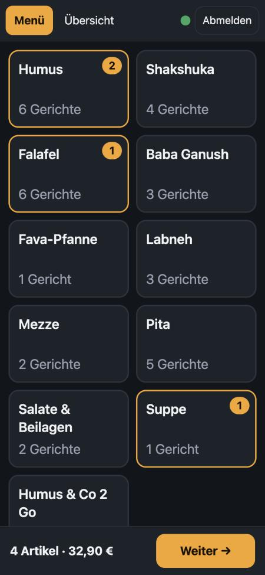
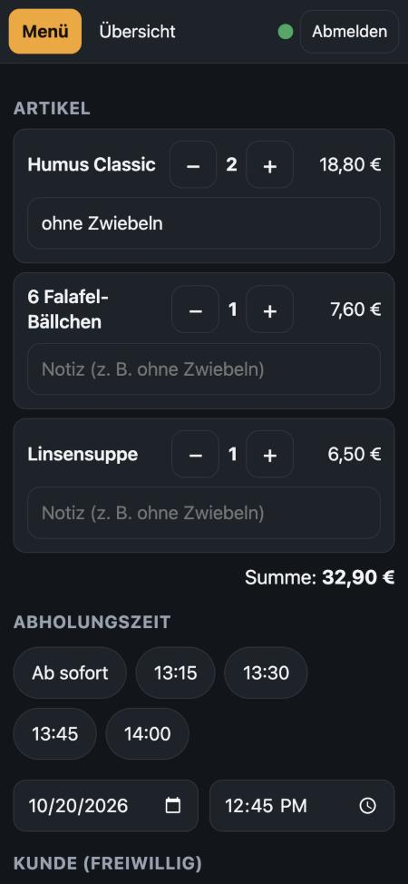
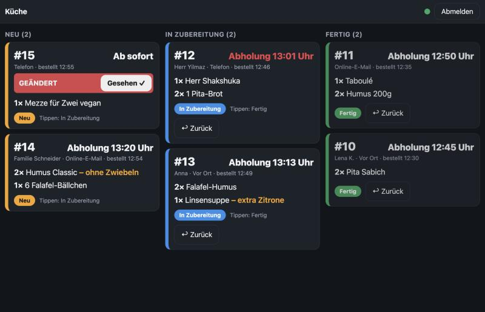
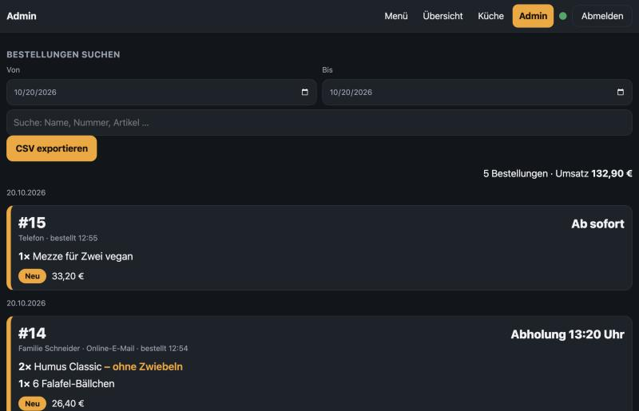

# Take-away Order System

A small real-time web app for restaurant take-away orders. Built for a restaurant that used to copy every phone, walk-in and email order into Apple Notes by hand. Runs in the mobile browser. The interface is in German.

Three roles, three screens, all synced live across any number of devices:

- **Kellner (waiter):** taps the order together from a category menu, picks a pickup time, sends it. Can still edit an order until the kitchen marks it done.
- **Küche (kitchen):** new orders appear instantly with a sound. One tap = "In Zubereitung", second tap = "Fertig". Edited orders are flagged.
- **Admin (chef):** looks up all orders for any date range, sees the revenue, and exports CSV.

## Screenshots

(Sample data.)

| Kellner: categories | Kellner: finish order |
|---|---|
|  |  |

**Küche** (tablet):



**Admin**:



## Try it

This copy is connected to a separate demo database with sample data only. Log in with:

| Role | E-mail | Password |
|---|---|---|
| Kellner | `kellner@gmail.com` | `kellner53117` |
| Küche | `kueche@gmail.com` | `kueche53117` |
| Admin | `chef@gmail.com` | `chef53117` |

Open two browser windows, log in as Kellner in one and Küche in the other, send an order and watch it arrive. These logins are public on purpose. Please do not enter real personal data.

To run it locally:

```bash
python3 -m http.server 8000
```

Then open `http://localhost:8000`.

## How it works

```
Browser (phone / tablet)  <-- WebSocket (live) -->  Supabase (EU, Frankfurt): Auth + Postgres + Realtime
        ^
   static files (HTML / CSS / JS)
```

- **No server code to run.** Supabase provides login, the database and the live connection (Realtime over WebSocket).
- **No framework and no build step.** Plain HTML, CSS and JavaScript, 5 small files. The only library is `supabase-js` from a CDN.
- **Live sync:** the database pushes every new or changed order to all connected screens. After a reconnect or wake-up, the app reloads open orders, and it also refreshes every 30 seconds as a safety net.
- **Security is enforced in the database**, not in the page. Row Level Security plus two triggers decide what each role may do:

| Role | Can read | Can write |
|---|---|---|
| Kellner | open orders and today's finished ones | create orders, edit orders that are not "Fertig" (never the status) |
| Küche | open orders and today's finished ones | status only |
| Admin | everything | everything |

- Sign-up is disabled. Accounts are created by hand.
- The anon key in `config.js` is public by design. It is useless without a login and the database rules.

## Design choices

- **Supabase instead of Firebase or a custom Node server:** real SQL makes the date search simple, and there is no server to maintain. The data stays in the EU.
- **Menu in a file (`menu.js`):** a menu editor would be extra code for about 40 items. Each saved order stores a copy of item names and prices, so old orders never change.
- **Prices in cents** to avoid rounding errors.
- **Sound is generated in code** (Web Audio), so no audio file is needed. The kitchen taps once to unlock sound, because browsers block it until then.

## Files

| File | Content |
|---|---|
| `index.html`, `style.css` | page and styling |
| `app.js` | all logic: login, Kellner, Küche, Admin |
| `menu.js` | the menu, prices in cents |
| `config.js` | Supabase URL and public anon key |
| `schema.sql` | tables, roles, triggers and access rules (run once) |

## Set up your own copy

1. Create a free Supabase project and turn off public sign-ups.
2. Create three users: `kellner@…`, `kueche@…`, `chef@…`. The part before the `@` sets the role.
3. Run `schema.sql` in the Supabase SQL Editor.
4. Put your project URL and anon key into `config.js`.
5. Host the files on any static host, for example Netlify or GitHub Pages.

## Ideas for later

- Import website orders automatically instead of typing them in
- Cancel button, and a menu editor for the admin
- Offline queue for sending orders without internet
- Prep-time statistics (start and finish times are already stored)
